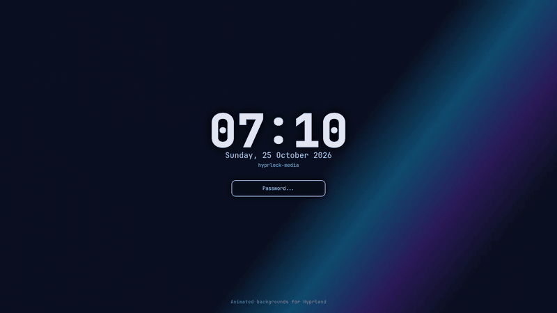

<div align="center">

# hyprlock-media

**Animated backgrounds and images for your Hyprland lock screen.**

A fork of [hyprlock](https://github.com/hyprwm/hyprlock) that can play GIFs,
animated WebP/APNG, and real video (MP4/WebM/MKV/...) as a background or as an
`image` widget.

[](LICENSE)
[](https://github.com/hyprwm/hyprlock)



</div>

## Why this fork

hyprlock renders a still image or a screenshot as its background. This fork adds
a media pipeline on top of the existing renderer, with a focus on staying usable
on low-power laptops:

- **One code path for motion**: GIF, animated WebP, APNG, AVIF, MP4, WebM, MKV,
  MOV, AVI, MPEG and TS are decoded by ffmpeg.
- **Background or widget**: the same media keys work on `background` and on
  `image`.
- **No main-thread decoding**: a worker thread decodes ahead into a small frame
  ring. Password input and the compositor event loop stay responsive even with
  HEVC video.
- **Resolution-aware**: frames are decoded at the size they are actually shown.
  A 4K clip used as a 300px badge is decoded at 600px, not 4K.
- **Blur-friendly**: with `blur_passes > 0` the video is decoded and blurred at
  half resolution, then upscaled.
- **Drop-in**: the binary is still `hyprlock`, the config stays hyprlock's
  config, and all existing widgets/animations keep working.

## Demo

The GIF above is a real capture of this fork running in a headless Sway session
(no compositor tricks): a gradient video as the background, live clock, date,
brand label, and input field.

## Features

- Animated `background` (`path = ~/wall.mp4`) and `image` widgets
  (`path = ~/spinner.gif`).
- `media_loop`, `media_fps`, `media_speed`, `media_scale` per widget.
- Async decode with frame dropping, loop, seek-on-stall, and wall-clock sync.
- Native support for hyprlock's blur, contrast, brightness, vibrancy, noise,
  rounded corners, borders, shadows and transforms.
- Static images keep using the original hyprgraphics path. Unsupported or
  corrupt media falls back to the static loader instead of leaving a blank
  widget.
- Everything else from upstream hyprlock: ext-session-lock, fractional scaling,
  PAM/fingerprint auth, labels, shapes, input field, animations.

## Requirements

- Hyprland with `ext-session-lock-v1` (or another compositor that implements it).
- A C++23 compiler, CMake ≥ 3.27, and `hyprwayland-scanner` ≥ 0.4.4.
- hyprlock's usual dependencies: hyprlang, hyprutils, hyprgraphics, wayland,
  wayland-protocols, wayland-egl, EGL/GLES3, xkbcommon, cairo, pangocairo,
  libdrm, gbm, sdbus-c++ ≥ 2.0, PAM.
- **ffmpeg development libraries**: libavformat, libavcodec, libavutil,
  libswscale.

On Arch Linux the full set is:

```sh
sudo pacman -S --needed base-devel cmake ffmpeg hyprlang hyprutils \
  hyprgraphics hyprwayland-scanner sdbus-cpp wayland wayland-protocols \
  cairo pango libdrm mesa pam
```

The package names differ on other distributions; install the `-dev`/`-devel`
variants of the libraries above.

## Build and install

```sh
git clone https://github.com/RaffaFachrizal29/hyprlock-media.git
cd hyprlock-media

cmake -S . -B build -DCMAKE_BUILD_TYPE=Release
cmake --build build -j$(nproc)

# optional
sudo cmake --install build
```

`cmake --install` installs the binary as `hyprlock`, the PAM file
`/etc/pam.d/hyprlock`, and the example config. It therefore replaces a packaged
hyprlock; uninstall or use a separate prefix if you want both.

Run it the same way as upstream:

```sh
hyprlock
hyprlock --config ~/.config/hypr/hyprlock.conf
hyprlock --immediate-render
```

## Quick start

Put a video or GIF in the background block:

```ini
background {
    monitor =
    path = ~/wallpapers/butterfly.mp4
    media_fps = 30
}
```

Use motion in a widget:

```ini
image {
    monitor =
    path = ~/wallpapers/spinner.gif
    size = 180
    position = 0, -220
    halign = center
    valign = center
    media_fps = 15
}
```

Everything else stays a normal hyprlock config. See
[`docs/CONFIGURATION.md`](docs/CONFIGURATION.md) for every key, defaults,
examples and troubleshooting, and [`docs/PERFORMANCE.md`](docs/PERFORMANCE.md)
for tuning on slow hardware.

## Configuration at a glance

| Key | Type | Default | Meaning |
|---|---|---|---|
| `path` | string | `""` | Still image, `screenshot`, GIF/WebP/APNG/AVIF, or video file. |
| `media_loop` | bool | `true` | Loop at the end. `false` holds the last frame. |
| `media_fps` | int | `0` | Display cap. `0` follows the source; `24`/`30` reduces CPU. |
| `media_speed` | float | `1.0` | Playback rate, e.g. `0.5` or `1.5`. |
| `media_scale` | float | `0` | Extra decode-size multiplier. `0` = auto; `0.75` = 75%. |

The same keys exist on `background` and `image`.

### Recommended values

- **Best quality**: `media_scale = 1` (or `0`), `media_fps = 0`.
- **Balanced laptop**: `media_fps = 30`.
- **Low CPU / battery**: `media_fps = 24`, `media_scale = 0.75`; add
  `blur_passes = 1` or `2` if you want the background soft anyway.
- **Static-looking lock**: `media_fps = 1` or `media_loop = false`.

## Performance

Measured on the development laptop (Intel i5-7200U, HD Graphics 620, 1080p,
`butterfly.mp4` = HEVC 1864×1080 30fps):

| Scenario | Before this fork's optimizations | After |
|---|---|---|
| 1 output | 28.9 fps, 8.9s CPU over 12s, decode on main thread | **~30 fps, 4.6s CPU over 10s**, main thread ~9% |
| 2 outputs, same background | two decoders + duplicated full-surface renders | both outputs 30fps, duplicated renders removed |
| 1080p + 3 blur passes | full-resolution blur/decode per frame | ~30fps with half-res decode/blur |

The important change is *where* the work happens: decoding no longer blocks the
event loop. See [`docs/PERFORMANCE.md`](docs/PERFORMANCE.md) for the benchmark
method and the remaining limitations.

## How it works

- `src/renderer/Media.*` — ffmpeg probing and decoding, RGBA conversion,
  output-size capping, seeking.
- `src/renderer/MediaPlayer.*` — worker thread, 3-frame ring, wall-clock
  playback, loop/speed/fps handling, shared redraw timer and output targeting.
- `CBackground` draws the player's texture directly when there is no blur or
  output transform; with blur it renders into a half-resolution FBO and blurs
  there.
- `CImage` rebuilds its offscreen framebuffer only when a new frame arrives.
- `CMediaManager` aligns all players to one epoch, wakes one timer at the next
  frame's timestamp, and renders only the outputs that are due.

## Compatibility and limitations

- Audio and subtitle streams are ignored; only the best non-cover video stream
  is used.
- Videos are decoded in software. VAAPI/hardware decode is not wired in yet;
  on Intel this would need `intel-media-driver` plus a dmabuf/EGL path.
- Each output decodes its own copy if the same file is used on multiple
  monitors. A per-monitor `media_fps` or `media_scale` is the cheap workaround.
- HDR/10-bit sources are converted to 8-bit RGBA (SDR).
- `media_scale` applies after the automatic size cap, so values above `1` do not
  upscale the source.
- The path extension decides whether the media player is used. A file with an
  unknown extension goes through the still-image loader.

## Testing

The repository includes two standalone harnesses, built only on request:

```sh
cmake -S . -B build -DCMAKE_BUILD_TYPE=Release -DHYPRLOCK_BUILD_TESTS=ON
cmake --build build -j$(nproc)

# decoder, scaling, async playback, loop, speed, orientation, bad file
./build/media_test /path/to/video.mp4 /path/to/animation.gif /path/to/still.webp

# config schema / defaults
./build/config_test ./my-test.conf
```

`media_test` uses EGL surfaceless and FBO readback, so it needs a working GL
driver but no compositor. For end-to-end testing, use a nested/headless
compositor; never test a lock screen against your live session.

## Upstream and license

This is an independent fork of [hyprwm/hyprlock](https://github.com/hyprwm/hyprlock),
based on v0.9.6. All credit for the original lock screen, renderer, widget
system and configuration language belongs to the hyprlock authors and
contributors.

Licensed under the BSD 3-Clause License; see [LICENSE](LICENSE). The upstream
copyright notice is retained.

If you only need a still background, use upstream hyprlock. If you find a bug in
this fork, please report it here rather than upstream.
